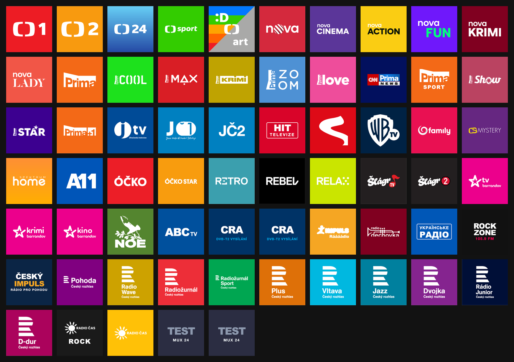
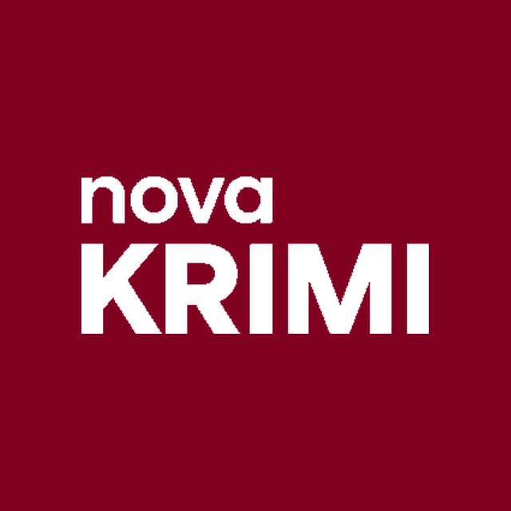
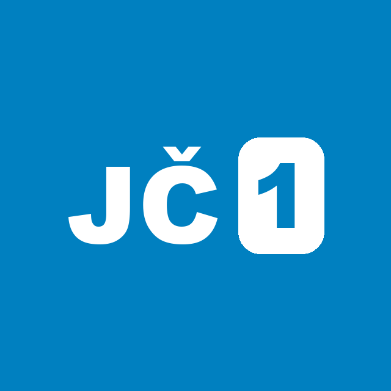
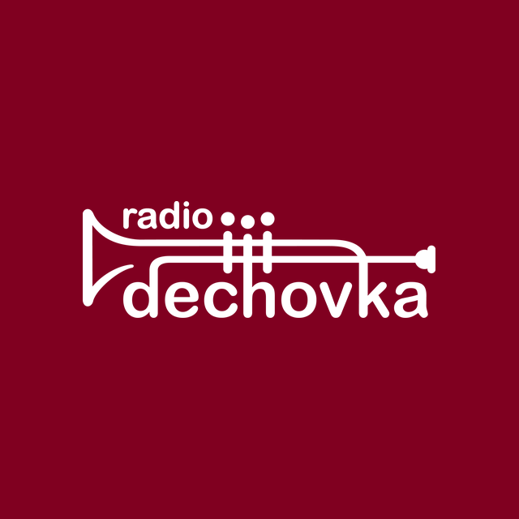

# 🎨 Modern Flat Picons for TV & Radio (CZ/SK & International)

[](https://github.com/onhala/picons/actions/workflows/ci.yml)
[](https://onhala.github.io/picons/)
[](https://onhala.github.io/picons/)
[](https://onhala.github.io/picons/)
[](LICENSE)

Prémiový balíček moderních, plochých televizních a rozhlasových ikon (piconů) navržený pro **Tvheadend**, **Kodi**, **Apple TV (TvhClient)**, **Enigma2** a **IPTV playlisty**. 

Tento repozitář je aktivně udržovaným a rozšířeným forkem původního projektu [MarhyCZ/picons](https://github.com/MarhyCZ/picons) s plným pokrytím moderního českého pozemního vysílání **DVB-T2**, regionálních stanic, rádií a integrovanou **automatizovanou CI/CD validační pipeline**.

👉 **[Prohlédnout interaktivní online galerii všech stanic](https://onhala.github.io/picons/)** (podporuje vyhledávání a přepínání tmavého/světlého režimu).

---

## 💎 Designový systém Marhyho Piconů

Většina běžných transparentních piconů selhává v kontrastu – na tmavém skinu zanikají tmavé části loga, na světlém skinu zase bílé. Marhyho styl tento problém řeší:

1. **Čtvercová dlaždice (1:1):** Přesné rozlišení **640×640 px** (pro 1080p panely a Kodi) a **1024×1024 px** (pro 4K panely a Retina displeje).
2. **Dominantní barva značky:** Pozadí tvoří sytá primární barva stanice (nebo jemný charakteristický přechod).
3. **Monochromní bílé logo (`#ffffff`):** Vycentrováno s přesnou šířkou cca **65–70 % canvasu**, zaručující 100% čitelnost na jakémkoliv skinu klientské aplikace.

---

## 📡 Přímé URL pro Tvheadend (Dynamic CDN)

Díky GitHub Pages není nutné balíček stahovat ani ručně nahrávat na disk. Tvheadend si ikony stahuje a cachuje dynamicky přes Service Name Picons (SNP) schéma:

* **Standardní rozlišení (640×640 px – doporučeno pro RPi / Apple TV):**
  ```text
  https://onhala.github.io/picons/640/%C.png
  ```
* **Vysoké rozlišení (1024×1024 px – pro 4K UHD panely):**
  ```text
  https://onhala.github.io/picons/1024/%C.png
  ```

### Příklad v M3U playlistu:
```text
#EXTINF:-1 tvg-logo="https://onhala.github.io/picons/640/ct1hdt2.png", CT 1 HD T2
#EXTINF:-1 tvg-logo="https://onhala.github.io/picons/640/warnertv.png", Warner TV
```

---

## ⚙️ Návod k nastavení v TVHeadendu

1. V rozhraní Tvheadendu přejděte do **Configuration** ➔ **General** ➔ **Base**.
2. V sekci **Picon**:
   * **Channel icon path:** `https://onhala.github.io/picons/640/%C.png`
   * **Channel icon name scheme:** `Service name picons` (SNP)
   * Uložte změny tlačítkem **Save**.
3. Přejděte do **Configuration** ➔ **Channel / EPG** ➔ **Channels**:
   * Zobrazte všechny kanály (`Show All` vpravo dole).
   * Označte všechny kanály klávesovou zkratkou `CTRL + A`.
   * Klikněte na tlačítko **Reset icon** a následně **Save changes**.
4. Tvheadend automaticky dotáhne loga do své interní paměti cache (`imagecache`), odkud se okamžitě distribuují do Apple TV, Kodi i mobilních klientů.

### ⚠️ Důležité: Vyčištění cache (Imagecache Purge) při každém nasazení

Tvheadend po stažení ikony ukládá soubory do své persistentní diskové mezipaměti (`/home/hts/.hts/tvheadend/imagecache/data/`) a **nikdy je automaticky neobnovuje**, i když se na CDN objeví novější verze pod stejným názvem.

**Při každé vizuální opravě, změně stylu nebo nasazení nových verzí piconů je nutné vyčistit imagecache Tvheadendu:**

* **Přes CaC nástroj v repozitáři `home-infrastructure` (Doporučeno):**
  ```bash
  python3 tools/tvheadend_sync.py --purge-imagecache
  ```

* **Nebo přímo přes SSH na serveru Tvheadend:**
  ```bash
  ssh ondrej@10.0.10.22 'sudo bash -c "systemctl stop tvheadend && rm -rf /home/hts/.hts/tvheadend/imagecache/data/* /home/hts/.hts/tvheadend/imagecache/meta/* && systemctl start tvheadend"'
  ```

Po restartu si Tvheadend okamžitě znovu stáhne aktuální čisté verze všech log z GitHub Pages CDN a rozešle je do připojených klientů (Apple TV TvhClient, Kodi atd.).

---

## 📺 Pokrytí stanic (100% stav DVB-T2 v ČR)

Repozitář pokrývá **všech 65 vysílaných DVB-T2 stanic a rádií v ČR**. Pro okamžitou lidskou kontrolu (Human-in-the-loop review) je níže sestaven **vždy aktuální vizuální render všech stanic vedle sebe**:

<p align="center">
  <a href="https://onhala.github.io/picons/">
    
  </a>
  <br>
  <em>💡 Kliknutím na přehled otevřete <a href="https://onhala.github.io/picons/">živou interaktivní galerii</a> s fulltextovým vyhledáváním a přepínačem tmavého/světlého režimu.</em>
</p>

### Detailní přehled stanic a multiplexů

| Ikona | Stanice / Rádio | Normalizovaný soubor | Multiplex | Stav loga |
|:---:|---|---|:---:|:---:|
|  | **ČT 1 HD T2** | `ct1hdt2.png` | MUX 21 | ✅ 640 + 1024 |
|  | **ČT 2 HD T2** | `ct2hdt2.png` | MUX 21 | ✅ 640 + 1024 |
|  | **ČT 24 HD T2** | `ct24hdt2.png` | MUX 21 | ✅ 640 + 1024 |
|  | **ČT Sport HD T2** | `ctsporthdt2.png` | MUX 21 | ✅ 640 + 1024 |
|  | **ČT :D / Art HD T2** | `ctdarthdt2.png` | MUX 21 | ✅ 640 + 1024 |
|  | **Nova** | `nova.png` | MUX 24 | ✅ 640 + 1024 |
|  | **Nova Cinema** | `novacinema.png` | MUX 24 | ✅ 640 + 1024 |
|  | **Nova Action** | `novaaction.png` | MUX 24 | ✅ 640 + 1024 |
|  | **Nova Fun** | `novafun.png` | MUX 24 | ✅ 640 + 1024 |
|  | **Nova Krimi** | `novakrimi.png` | MUX 24 | ✅ 640 + 1024 |
|  | **Nova Lady** | `novalady.png` | MUX 24 | ✅ 640 + 1024 |
|  | **Prima** | `prima.png` | MUX 22 | ✅ 640 + 1024 |
|  | **Prima COOL** | `primacool.png` | MUX 22 | ✅ 640 + 1024 |
|  | **Prima MAX** | `primamax.png` | MUX 22 | ✅ 640 + 1024 |
|  | **Prima KRIMI** | `primakrimi.png` | MUX 22 | ✅ 640 + 1024 |
|  | **Prima LOVE** | `primalove.png` | MUX 22 | ✅ 640 + 1024 |
|  | **Prima ZOOM** | `primazoom.png` | MUX 22 | ✅ 640 + 1024 |
|  | **Prima STAR** | `primastar.png` | MUX 22 | ✅ 640 + 1024 |
|  | **Prima SHOW** | `primashow.png` | MUX 22 | ✅ 640 + 1024 |
|  | **Prima +1** | `prima1.png` | MUX 22 | ✅ 640 + 1024 |
|  | **Prima sport** | `primasport.png` | MUX 24 | ✅ 640 + 1024 |
|  | **CNN Prima News** | `cnnprimanews.png` | MUX 22 | ✅ 640 + 1024 |
|  | **Warner TV** | `warnertv.png` / `test4.png` | MUX 23 | ✅ 640 + 1024 |
|  | **A11** | `a11.png` | MUX 23 | ✅ 640 + 1024 |
|  | **Seznam.cz TV** | `seznamcztv.png` | MUX 23 | ✅ 640 + 1024 |
|  | **Hit TV** | `hittv.png` / `test5.png` | MUX 24 | ✅ 640 + 1024 |
|  | **ABC TV** | `abctv.png` | MUX 24 | ✅ 640 + 1024 |
|  | **TV Barrandov** | `tvbarrandov.png` | MUX 23 | ✅ 640 + 1024 |
|  | **Kino Barrandov** | `kinobarrandov.png` | MUX 23 | ✅ 640 + 1024 |
|  | **Barrandov Krimi** | `barrandovkrimi.png` | MUX 23 | ✅ 640 + 1024 |
|  | **Šlágr Originál** | `slageroriginal.png` | MUX 24 | ✅ 640 + 1024 |
|  | **Šlágr Muzika** | `slagermuzika.png` | MUX 24 | ✅ 640 + 1024 |
|  | **JTV (Jihočeská TV)** | `jtv.png` | MUX 24 | ✅ 640 + 1024 |
|  | **JČ1 & JČ2** | `jc1.png`, `jc2.png` | RS 18 | ✅ 640 + 1024 |
|  | **Rádio Impuls** | `radioimpuls.png` | MUX 22 | ✅ 640 + 1024 |
|  | **Český Impuls** | `ceskyimpuls.png` | MUX 24 | ✅ 640 + 1024 |
|  | **ČRo Pohoda** | `cropohodat2.png` | MUX 21 | ✅ 640 + 1024 |
|  | **ČRo Radiožurnál Sport**| `crorzsportt2.png` | MUX 21 | ✅ 640 + 1024 |
|  | **Radio Čas & Čas Rock** | `radiocas.png`, `radiocasrock.png` | MUX 24 | ✅ 640 + 1024 |
|  | **Radio Dechovka** | `radiodechovka.png` | MUX 23 | ✅ 640 + 1024 |
|  | **RockZone 105.9** | `rockzone1059.png` | MUX 24 | ✅ 640 + 1024 |
|  | **Ukrajinské Rádio** | `ukrajinskeradio.png` | MUX 23 | ✅ 640 + 1024 |


---

## 🛠️ Validační Pipeline a Testování Kvality

Součástí repozitáře je automatizovaný kontrolní skript [`tools/validate_picons.py`](tools/validate_picons.py), který je spouštěn v rámci GitHub Actions při každém pushi i pull requestu:

1. **Parita rozlišení:** Kontroluje, že každý soubor v `640/` má identický protějšek v `1024/`.
2. **Přesné rozměry a formát:** Striktně vyžaduje rozměr 640×640 px a 1024×1024 px ve formátu PNG.
3. **Detekce mikroskopických log:** Bounding box loga musí zabírat minimálně 35 % šířky canvasu (zabraňuje nechtěně zmenšeným ikonám).
4. **Detekce plných ploch / maskovacích chyb:** Měří vnitřní odchylku bodů loga (`stddev`), aby odhalil chybné masky (neprohledné plné čtverce bez výřezu).
5. **Konzistence hardlinků:** Validuje integritu a existenci aliasů definovaných v [`source/hardlinks.sh`](source/hardlinks.sh).
6. **Automatická tvorba galerie:** Po úspěšném testu vygeneruje interaktivní náhledovou galerii [`build/gallery.html`](build/gallery.html) a publikuje ji na GitHub Pages.

### Lokální spuštění validace:
```bash
python3 tools/validate_picons.py --gallery
```

Automatická oprava rozměrů nebo parity:
```bash
python3 tools/validate_picons.py --fix
```

---

## 🤝 Přispívání a generování nových stanic

Nové picony lze vytvářet poloautomaticky pomocí připraveného skriptu:
1. Zjistěte oficiální vektorový SVG nebo transparentní PNG podklad stanice.
2. Zadejte primární barvu pozadí značky.
3. Spusťte generátor:
   ```bash
   python3 generate_missing_picons.py
   python3 tools/validate_picons.py --gallery
   ```
4. Zkontrolujte výstup v `build/gallery.html`, commitněte a vytvořte Pull Request.

---

## 📜 Licence & Poděkování

* Původní designový koncept a základní sada ikon: **MarhyCZ** ([MarhyCZ/picons](https://github.com/MarhyCZ/picons)).
* Rozšíření, DVB-T2 podpora a CI validace: **Ondřej Hála** ([onhala/picons](https://github.com/onhala/picons)).
* Licence: **MIT License**. Loga televizních a rozhlasových stanic jsou duševním vlastnictvím příslušných vysílatelů.
